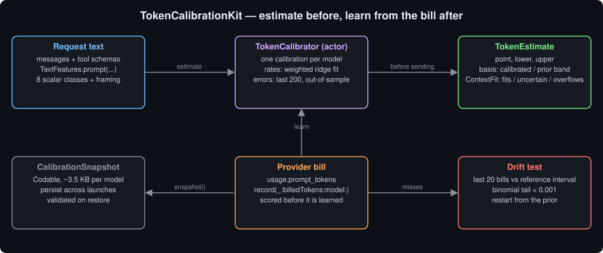
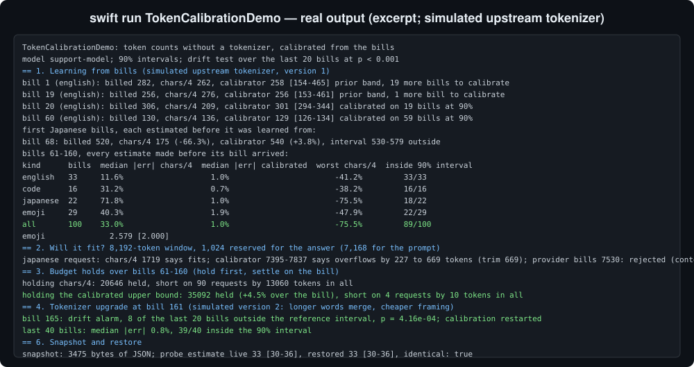
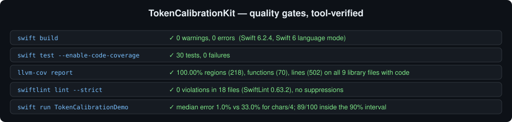

# TokenCalibrationKit

Count an LLM request's tokens before you send it, without the provider's tokenizer, and learn each
model's real rates from the bills it sends back.



## The problem

An app that talks to many models through a router rarely has their tokenizers. OpenRouter counts usage
with each model's own tokenizer, Anthropic's is not public, and the open-weights models each ship a
different one. So the app guesses, and the usual guess is `characters / 4`.

That guess decides real things before the request leaves the device: how much budget to hold, whether the
conversation needs compacting, whether the request fits the model's context window at all. It is fine for
English prose. It is badly wrong elsewhere:

- **CJK text** costs about a token per character, not a quarter of one. A Japanese conversation
  under-counts by 2-4x, and the request that "fits" comes back as a context-length error.
- **Code and JSON** are dense with symbols, each often a token of its own.
- **Emoji** can cost several tokens each; a family emoji is five scalars.
- **Framing** is invisible to a character count: role markers per message, the tool definitions, a fixed
  overhead per request.
- **Tokenizers change.** A model update ships a new vocabulary and yesterday's ratio quietly drifts.

The provider tells you the truth after every call: `usage.prompt_tokens`. Most apps meter it and throw the
lesson away.

## What it does

- **`TextFeatures`** counts a request by **`ScalarClass`**: ASCII letters, digits, whitespace, ASCII
  symbols, CJK, other letters, emoji (per grapheme) and everything else, plus one count each for messages,
  tool definitions and the request itself. `TextFeatures.prompt(messages:toolSchemas:)` builds a chat
  request's features; `TextFeatures(text:)` has no framing, for completion text.
- **`TokenRates`** is a linear model, tokens per unit of each feature. `standardPrior` is a starting point
  (4.5 English letters per token, 1.2 per CJK character, 2 per emoji, 4 per message frame, ...), not a
  measured tokenizer.
- **`TokenCalibrator`** (an actor) keeps one calibration per model.
  - `estimate(_:model:)` and `estimatePrompt(messages:toolSchemas:model:)` return a **`TokenEstimate`**:
    a point, a lower and an upper bound, and an **`EstimateBasis`** saying where the interval came from.
  - `record(_:billedTokens:model:)` learns from one bill. It first scores the bill against the estimate
    it would have made without it, and returns that as a **`CalibrationUpdate`** (the estimate, whether
    the bill fell inside it, and any drift alarm).
  - `report(for:)` gives a **`CalibrationReport`**: bills, resets, the rates in use, and how many bills
    fell inside their interval.
  - `snapshot()` and `init(restoring:)` persist everything as `Codable` **`CalibrationSnapshot`** data.
- **`ContextFit`** compares an estimate with `contextWindow - reservedOutput`: `.fits(headroom:)`,
  `.uncertain(worstCaseOverflow:)` or `.overflows(by:worstCaseOverflow:)`, with `tokensToTrim` measured at
  the upper bound.
- **`CalibrationConfiguration`**: coverage (90% by default), the error window (200), shrinkage toward the
  prior (5%), the band used before there are enough bills (0.6x to 1.8x), and the drift test (the last 20
  bills at p < 0.001). Every value is validated.

No dependencies. Swift 6, strict concurrency, every public type `Sendable`.

## How it learns, and what it claims

**The rates** are a weighted least-squares fit of the bills, solved after every bill from an 11x11 matrix
that stands in for all of them. Each bill is weighted by `1 / billed`, so the fit minimises relative error
and one long prompt does not drown out a hundred short ones. Every rate is pulled toward the prior by a
small anchor plus 5% of its own evidence. That does two things: a class no bill has contained (CJK, before
the first Japanese message) stays exactly at the prior instead of being guessed from noise, and the system
is always positive definite, so a Cholesky solve always succeeds. A rate the fit would make negative is
clamped to zero.

**The interval** is split-conformal. Every bill is first predicted by the model as it stood *before* that
bill, and the error `log(billed / estimate)` is kept. The interval is the order statistics of the last 200
of those errors, so it is built from out-of-sample errors only. At 90% coverage it needs 19 of them; until
then the estimate says so (`.priorBand(billsNeeded:)`) and uses the configured band. The point is the fit
corrected by the median error.

The coverage claim assumes the errors are exchangeable. They are not quite: the model improves as it
learns, so early errors are larger than later ones, which makes the interval conservative rather than
optimistic. `CalibrationReport.empiricalCoverage` reports what actually happened, and the demo prints it.

**Drift.** A few drifted bills are enough to stretch the live interval over themselves: with 60 errors the
lower bound is the third smallest, so three drifted bills move it. The first version of the drift test
checked bills against that live interval and never fired. So drift is judged against a *reference*
interval built from the errors older than the last 20 bills. If too many of the last 20 bills fall outside
it to be chance at the claimed coverage (a binomial tail below 0.001, which at 90% means 8 or more of 20),
the calibrator decides the tokenizer changed, starts that model again from the prior, and keeps only the
bill that raised the alarm.

## Measured

All figures are from `swift run TokenCalibrationDemo`. The demo has no real tokenizer: every billed count
comes from `ReferenceTokenizer`, a rule-based stand-in that is deliberately *not* the calibrator's prior.
Read these as a simulation of the method, not a measurement of any real model.

| Bills 61-160, each estimated before its bill | bills | median error, chars/4 | median error, calibrated | inside the 90% interval |
|---|---|---|---|---|
| English | 33 | 11.6% | 1.0% | 33/33 |
| Code | 16 | 31.2% | 0.7% | 16/16 |
| Japanese | 22 | 71.8% | 1.0% | 18/22 |
| Emoji-heavy | 29 | 40.3% | 1.9% | 22/29 |
| **All** | **100** | **33.0%** | **1.0%** | **89/100** |

- **The first Japanese request** (bill 68) was billed 520 tokens. `chars/4` said 175 (-66.3%). The
  calibrator had never seen CJK text, but its prior has a CJK rate, and it said 540 (+3.8%).
- **Context window** (8,192 tokens, 1,024 reserved for the answer). `chars/4` called a Japanese request
  1,719 tokens and said it fits; it was billed 7,530 and would have been rejected. The calibrator said it
  overflows by 227 to 669 tokens. Of four requests near the limit, `chars/4` got two wrong. The calibrator
  called two correctly as overflowing and one correctly as fitting; the fourth, which fit with 35 tokens to
  spare, it called "may overflow by up to 177".
- **Budget holds.** Holding `chars/4` for the 100 mixed requests held 20,646 tokens against 33,591 billed
  and was short on 90 of them. Holding the calibrated upper bound held 35,092 (+4.5%) and was short on 4,
  by 10 tokens in all.
- **Tokenizer upgrade** at bill 161: the alarm fired at bill 165 (8 of the last 20 outside the reference
  interval, p = 4.16e-04). Over the last 40 bills after it: median error 0.8%, 39/40 inside.
- **Snapshot**: 3,475 bytes of JSON; the restored calibrator's estimate is identical.

## Usage

```swift
import TokenCalibrationKit

let calibrator = TokenCalibrator()
let model = "openai/gpt-4o"
let messages = [systemPrompt, history, question]

// Before the request: estimate, check the window, hold the upper bound.
let estimate = try await calibrator.estimatePrompt(messages: messages, toolSchemas: toolJSON, model: model)
switch try ContextFit(estimate: estimate, contextWindow: 128_000, reservedOutput: 1_024) {
case .fits:
    break
case let .uncertain(worstCaseOverflow):
    print("compact \(worstCaseOverflow) tokens first, or accept the risk")
case let .overflows(least, _):
    print("do not send: it is at least \(least) tokens over")
}
let tokensToHold = estimate.upper

// After the response: teach it the bill.
let features = TextFeatures.prompt(messages: messages, toolSchemas: toolJSON)
let update = try await calibrator.record(features, billedTokens: promptTokens, model: model)
if let drift = update.drift {
    print("tokenizer changed: \(drift.outside) of \(drift.window) bills outside, p = \(drift.pValue)")
}
```

Persist across launches:

```swift
let data = try JSONEncoder().encode(await calibrator.snapshot())
let restored = try TokenCalibrator(restoring: JSONDecoder().decode(CalibrationSnapshot.self, from: data))
```

**With ProviderGatewayKit**, pass each `LLMMessage`'s `content` as the messages and the response's prompt
token count as the bill. **For completion text**, use `TextFeatures(text:)` under a separate key (for
example `"openai/gpt-4o#output"`) and bill it the completion tokens minus any reasoning tokens, which are
billed but never streamed.

## Design notes

- **Why not ship tokenizers?** They are large, change with model releases, and most are not public. The
  bill is free, exact and always current.
- **Why per-class rates and not one ratio?** One ratio learned on English is wrong for the first Japanese
  conversation, and a single ratio cannot hold framing. Per-class rates let the prior cover what the bills
  have not shown yet.
- **Why judge drift against a reference window?** The live interval adapts within a few bills, which is
  what you want for estimates and exactly what hides a step change from a coverage test.
- **What it cannot see.** Images and audio are not text; their tokens need their own accounting. Hidden
  text a router adds is learned as framing only if it is the same size every time.

## Demo

```bash
swift run TokenCalibrationDemo
```



The full output is in [`Screenshots/demo-output.txt`](Screenshots/demo-output.txt).

## Quality



- `swift build`: 0 warnings, 0 errors (Swift 6.2.4, Swift 6 language mode).
- `swift test --enable-code-coverage`: 30 tests, 0 failures.
- `llvm-cov report`: 100.00% regions (218), functions (70) and lines (502) on all 9 library files that
  contain executable code (`CalibrationError.swift` only declares an enum).
- `swiftlint lint --strict` (SwiftLint 0.63.2): 0 violations, 18 files, no suppressions.

## Part of a series

One of a set of Swift packages built around
[ProviderGatewayKit](https://github.com/rajatslakhina/foundation-model-provider-gateway). Related:
[TokenMeterKit](https://github.com/rajatslakhina/token-meter-kit) meters reported usage,
[QuotaGovernorKit](https://github.com/rajatslakhina/quota-governor-kit) holds and settles budget,
[ContextCompactionKit](https://github.com/rajatslakhina/context-compaction-kit) trims a conversation to a
budget, and [UsageRecoveryKit](https://github.com/rajatslakhina/usage-recovery-kit) bounds a call whose
usage never arrived. They all compose in
[llm-ecosystem-demo](https://github.com/rajatslakhina/llm-ecosystem-demo), and run inside a real send
pipeline in [ai-chat-app](https://github.com/rajatslakhina/ai-chat-app).

## License

MIT. See [LICENSE](LICENSE).
